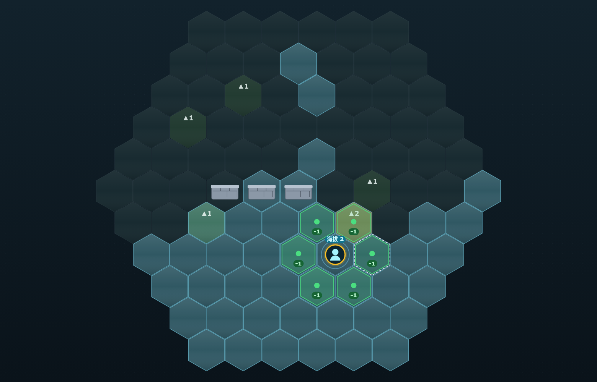
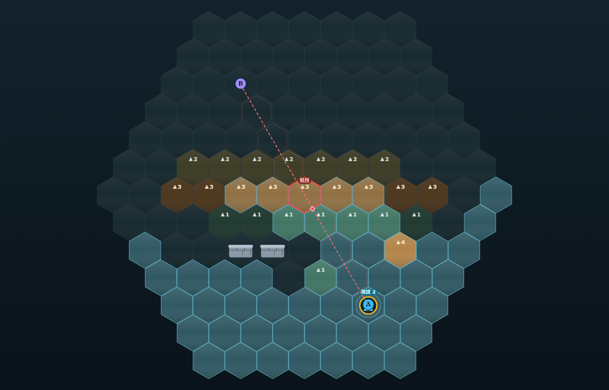
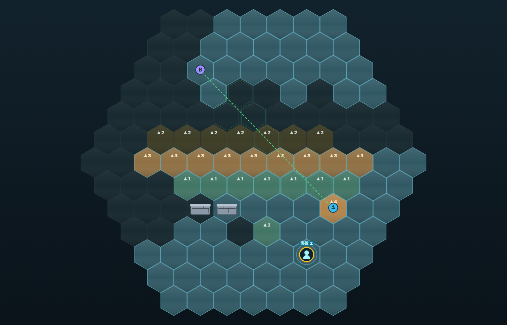

# 六边勘测 · Hex Survey

一个**原创**的六边格地形勘测小游戏（TypeScript + Canvas 2D，零运行时依赖、无任何远程素材）。
玩家在有限预算内移动、观测，标定隐藏在地形中的信标；坡地与石墙会遮挡视线，
能看到什么取决于观测点的海拔与观测高度。



---

## 运行

需要 Node.js 20+（开发时使用 Node 22）。

```sh
cd hex-survey
npm install        # 仅安装 typescript 与 @types/node（开发依赖）
npm start          # 构建 TS -> dist/ 并启动零依赖静态服务器
# 打开 http://localhost:4177/
```

也可以分两步：

```sh
npm run build      # tsc 严格模式构建到 dist/
node scripts/serve.mjs 4177
```

> 请通过 `http://` 访问，而不是直接双击 `index.html`（浏览器会以 `file://` 拦截本地 JSON 地图）。
> 页面右上角也支持「载入地图 / 读取存档」选择本地 JSON。

## 测试

```sh
npm test
```

测试会先用 `tsconfig.test.json` 把 `src/` 与 `test/` 编译到 `dist-test/`，再用
`node --test` 运行 30 个用例，覆盖：

- 六边坐标 / UV 整数坐标 / 像素往返；
- 视线裁定：石墙、较高地形、**精确擦公共边 / 只擦一个顶点 / 齐平放行**；
- 引擎：合法行动、预算、观测标定、**撤回同时还原预算与发现**；
- 存档序列化/读取校验、**固定地图 + 行动重放结果深度一致**；
- 两张内置地图的关键性质与「预算内必可解」（Dijkstra 求解器证明）；
- Canvas 渲染冒烟（mock 2D 上下文跑通全部绘制路径并检查 NaN 坐标）。

---

## 玩法

- **预算**是唯一资源。每移动 1 格、每次观测都按关卡 JSON 明示的数额扣预算。
- 地图上绿色亮格 + `−1` 徽章是**当前合法移动**；预算不足的相邻格显示灰色；石墙/障碍不可进入。
- 选择观测姿态（高度/消耗不同）后点「观测」：本次视线内的信标会被**永久标定**，
  视线内所有格写入「上次记录」。
- 图层含义：
  - 青色描边/薄染 = **当前视线可见**（随位置、姿态实时变化，仅是预览，不消耗预算）；
  - 琥珀色虚线框 = **曾观测记录**（保留上次结果与记录步数）；
  - 暗色迷雾 = 既没有记录、当前也看不见；
  - 金色三脚架 = 已标定信标，移动 / 重绘 / 读档都不会丢失。
- **撤回**（或 `Ctrl/⌘+Z`）：删掉最后一个行动并从初始局面重放，预算、记录、已发现状态一并回退。
- **保存存档**下载一个 JSON（内嵌地图 + 完整行动序列）；**读取存档**会完整重放校验。
- **重放本局**：可播放 / 单步 / 拖动进度条复盘每一步。
- **提示**：内置小型 Dijkstra，给出从当前局面、剩余预算出发的最省下一步。

### 视线裁定实验室（页面侧栏）

切到「视线裁定查询」，依次点 **A 观测格** 与 **B 目标格**：

- A 可以是**任意格**，不必是勘测员；
- 面板给出畅通 / 被哪一格首先挡住、遮挡顶高、接触参数与视线高度；
- 「显示 A 格可视域」会把整片青色可视集合改成该任意观测格的结果；
- 在普通检视面板点任意格，也能直接看到「勘测员 → 此格」为什么看不见、被谁挡住。



---

## 两关设计

| 地图 | 演示内容 |
| --- | --- |
| **风语石滩** `maps/open-plain.json` | 开阔地形的正常搜索；残墙遮挡墙后信标（需绕到墙端）；矮丘在站立视点下遮挡、切换「观测杆 +4」后原地越过，直观展示观察高度对视野的影响。 |
| **断脊岭** `maps/ridgeline.json` | 东西向 `height=3` 山脊 + `height=2` 副脊完全挡住岭北信标：测试保证南侧所有 `r≥1` 且 `h≤1` 的低地格都看不见它，**只有登上 `(2,2)` 的 `h=4` 瞭望岩（或山脊本身）才能越过**。预算内存在可完成路线（测试与求解器锁定）。 |



---

## 地图文件格式

地图是 `maps/*.json`，`format` 固定为 `"hex-survey-map@1"`，加载时经 `validateMap` 严格校验。
所有坐标为尖顶六边格的**轴坐标 `{q,r}`**，地图形状为半径 `radius` 的六边形。

```jsonc
{
  "format": "hex-survey-map@1",
  "id": "open-plain",
  "name": "风语石滩",
  "brief": "关卡说明……",
  "shape": { "kind": "hex", "radius": 5 },
  "start": { "q": 0, "r": 2 },

  "budget": 10,                    // 总预算
  "costs": { "move": 1, "observe": 2 }, // 每次移动 / 缺省观测消耗（关卡明示）
  "eyeHeight": 2,                  // 缺省视点高出地块的级数
  "wallHeight": 3,                 // 石墙高出地块的缺省级数
  "visionRange": 6,                // 可选视距（六边距离）
  "stances": [                     // 可选观测高度与各自消耗
    { "id": "stand", "label": "站立观测", "eye": 2, "cost": 2 },
    { "id": "mast",  "label": "观测杆登高", "eye": 4, "cost": 3 }
  ],

  "heights": { "1,1": 2 },         // "q,r" -> 地块海拔（未列=0）
  "obstacles": [                   // 障碍：wall / spire / rock，extra 为高出地面的级数
    { "q": -2, "r": 0, "kind": "wall" }
  ],
  "beacons": [ { "id": "near", "q": 2, "r": 2, "name": "路标信标" } ],
  "parBudget": 7,                  // 可选：干练评价参考
  "tips": ["……"]
}
```

存档格式：

```jsonc
{ "app": "hex-survey", "format": 1, "savedAt": "…", "map": { /* 完整地图 */ },
  "actions": [ { "type": "move", "to": {"q":1,"r":0} },
               { "type": "observe", "stanceId": "stand" } ] }
```

---

## 视线（LOS）一致性裁定

代码见 `src/los.ts`。为了让「刚好擦过边界」有唯一、可测的结论，没有使用带 epsilon 的浮点遍历：

1. 采用仿射整数坐标 **`U = 2q + r`、`V = 3r`**。六边中心与六个顶点在 `(U,V)` 下全是整数，
   直线段参数 `t∈[0,1]` 保持不变。
2. 对每个候选格，用六条整数半平面不等式（`|u|≤1`、`|u+v|≤2`、`|v-u|≤2`）做区间裁剪，
   **精确分数（bigint）**求出线段落在该格闭区域内的参数区间 `[lo,hi]`。
   闭区间意味着只在一个顶点擦过（`lo==hi`）或沿公共边走过的格也纳入裁定。
3. 地块视为顶面海拔 `height` 的等高棱柱；障碍把该格遮挡顶抬到 `height + extra`。
   视线高度沿 `t` 线性变化，区间上的最小值必在端点，因此：
   `存在 t 使 sightZ(t) < blockTop`（**严格小于**）才判定遮挡；
   视线与遮挡顶**恰好齐平时放行**（「齐平可过」）。
4. 多个格在同一参数点形成遮挡时，按 `hitT`、再按 `(q,r)` 字典序确定首要阻挡格，
   并返回全部阻挡格与共点信息，因此查询结果稳定、可复现。

`test/los.test.ts` 用手工构造的精确用例锁定了：

- `(0,0)→(1,1)` 视线沿 `(1,0)` 与 `(0,1)` 的公共边走过，区间恰为 `[1/3,2/3]`；
- `(0,0)→(-4,-1)` 只在 `t=1/3` 的顶点擦过 `(-1,-1)`（零长度区间）；
- 上述情形中顶高与视线齐平 → 放行，再加 1 级 → 挡住并报出该格。

---

## 目录结构

```
hex-survey/
├── index.html            # 页面骨架（侧栏 / 画布 / 回放条 / 结算层）
├── styles.css            # 全部样式（本地，无字体/CDN）
├── maps/                 # 两份 JSON 关卡
│   ├── open-plain.json
│   └── ridgeline.json
├── src/                  # TypeScript 源码
│   ├── hex.ts             # 六边坐标 + UV 整数坐标 + 像素变换
│   ├── los.ts             # 精确视线 / 可视域 / 阻挡查询
│   ├── mapio.ts           # 地图类型、校验、查询
│   ├── engine.ts          # 纯函数状态机、replay、撤回基础、存档
│   ├── solve.ts           # Dijkstra 提示 / 关卡可解性证明
│   ├── render.ts          # Canvas 2D 原创图形渲染
│   └── main.ts            # DOM 装配、交互、保存/读取/回放
├── test/                 # node:test 用例（npm test）
├── scripts/
│   ├── serve.mjs          # 零依赖静态服务器
│   ├── design.mjs         # 地图视线/求解诊断小工具
│   ├── spots.mjs          # 枚举能看见某信标的观测位
│   ├── dom-smoke.mjs      # 可选 jsdom 交互冒烟（需 npm i --no-save jsdom）
│   └── shot.mjs           # 可选真实 Canvas 截图（需 npm i --no-save @napi-rs/canvas）
└── docs/                  # README 用截图
```

## 确定性设计

唯一事实源是 **`map + actions[]`**：`state = replay(map, actions)`。
撤回 = 删末尾行动后重放；存档 = 序列化 `map + actions`；回放 = 对行动前缀逐个 replay。
核心逻辑不使用随机数、不读时钟，因此固定地图与操作在载入后结果必然一致
（测试对存档往返后的完整状态做 `deepEqual`）。

---

仓库原有的 `renderer/` Canvas 场景树示例**未做任何改动**；本工具完全位于独立的 `hex-survey/` 目录。
